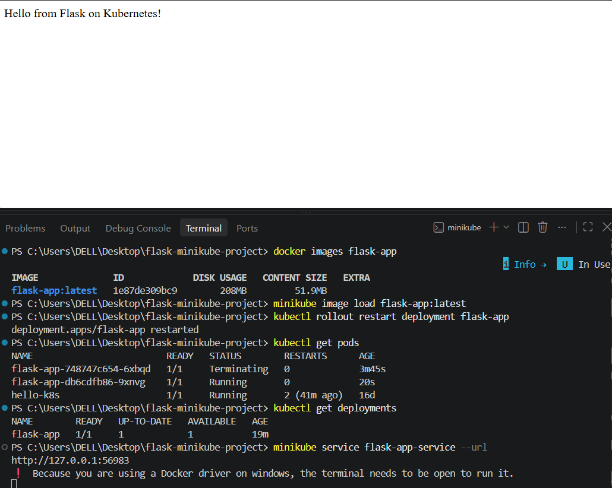

# Flask Application Deployment using Docker and Minikube

## Project Overview

This exercise demonstrates how to containerize a Flask application using Docker and deploy the application on Kubernetes using Minikube.

## Technologies Used

* Python
* Flask
* Docker
* Kubernetes
* Minikube
* kubectl
* Git/GitHub

## Project Structure

```text
flask-minikube-project/
├── app.py
├── Dockerfile
├── requirements.txt
├── deployment.yaml
├── service.yaml
├── output/
│   └── flask-minikube-output.png
└── README.md
```

## Docker Image

The Flask application was packaged into a Docker image:

```text
flask-app:latest
```

The image was loaded into Minikube and used by the Kubernetes deployment.

## Kubernetes Deployment

The application was deployed using Kubernetes and Minikube.

The deployment was verified using:

```bash
kubectl get pods
```

The Flask pod successfully reached the `Running` state.

## Running the Project

Start Minikube:

```bash
minikube start
```

Load the Docker image:

```bash
minikube image load flask-app:latest
```

Apply the Kubernetes deployment:

```bash
kubectl apply -f deployment.yaml
```

Apply the service:

```bash
kubectl apply -f service.yaml
```

Check the pods:

```bash
kubectl get pods
```

Check the services:

```bash
kubectl get services
```

## Output

The successful deployment/output screenshot is available here:


## Result

The Flask application was successfully containerized using Docker and deployed as a Kubernetes Pod using Minikube.
